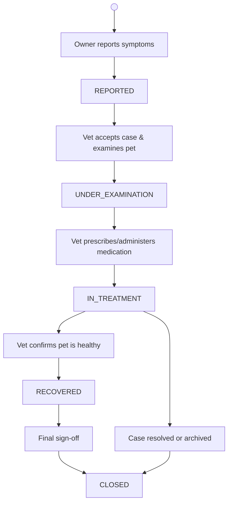

# PetTrack – Pet Health Management System (Backend API)

PetTrack is a backend REST API system built with **NestJS**, **TypeScript**, and **MongoDB (Mongoose)** designed to help pet owners and veterinarians identify common pet diseases, report illness cases, monitor recovery, and manage medical treatments and vaccinations.

---

## 🚀 Tech Stack

- **Framework**: NestJS (Node.js & TypeScript)
- **Database**: MongoDB with Mongoose ODM
- **Validation**: `class-validator` & `class-transformer`
- **Telemetry**: NestJS Observe
- **API Testing**: Thunder Client / Postman

---

## 👥 Role Permissions Matrix

| Feature / Action | Pet Owner (`OWNER`) | Veterinarian (`VET`) | Admin (`ADMIN`) |
| :--- | :--- | :--- | :--- |
| **Manage Pets** | Create, read, update own pets only | Read details of pets under examination/treatment | Full CRUD on all pets |
| **Diseases Catalog** | Read-only (browse conditions & symptoms) | Read-only (or Create/Edit if configured) | Full CRUD (manage database catalog) |
| **Symptom Checker** | Query observed symptoms + species | Query observed symptoms + clinical view | Full access |
| **Health Cases** | Create cases for own pets; view own history | Create cases on behalf of owners; view assigned/all cases | Full CRUD across all cases |
| **Status Transition** | Cannot change status (prevents self-diagnosis) | Advance cases through intake, treatment, & recovery | Full override on all states |
| **Treatments & Vaccines** | Read-only (view pet's care plan & vaccine schedule) | Create & log administered medications/vaccinations | Full CRUD |

---

## 🔄 Health Case Lifecycle & State Machine



### Transition ASCII Flow
```text
               ┌────────────────────────┐
               │        REPORTED        │  (Created by Owner or Vet)
               └───────────┬────────────┘
                           │
                           ▼ (Vet begins triage/exam)
               ┌────────────────────────┐
               │   UNDER_EXAMINATION    │
               └───────────┬────────────┘
                           │
                           ▼ (Diagnosis confirmed, meds prescribed)
               ┌────────────────────────┐
               │      IN_TREATMENT      │
               └───────┬────────┬───────┘
                       │        │
     (Pet responds to  │        │ (Chronic case, referred out,
            treatment) │        │  or administrative resolution)
                       ▼        │
               ┌──────────┐     │
               │RECOVERED │     │
               └────┬─────┘     │
                    │           │
                    ▼           ▼
               ┌────────────────────────┐
               │         CLOSED         │  (Archived / Final sign-off)
               └────────────────────────┘
```

### Guard Rules in Code
- **`REPORTED` ➔ `UNDER_EXAMINATION`**: Allowed only for `VET` or `ADMIN`.
- **`UNDER_EXAMINATION` ➔ `IN_TREATMENT`**: Requires at least one provisional disease ID or clinical note.
- **`IN_TREATMENT` ➔ `RECOVERED`**: Allowed only for `VET` or `ADMIN`.
- **`RECOVERED` or `IN_TREATMENT` ➔ `CLOSED`**: Vet final sign-off or Admin archive.
- **Owner cancellation**: An `OWNER` can cancel/close a case **only** if it is still in `REPORTED` status and has not yet been picked up by a vet.

---

## 🩺 Symptom Checker Mechanism (Phase 4 Scope)

- **Route**: `POST /diseases/symptom-check`
- **Request DTO**:
  ```typescript
  {
    species: 'DOG' | 'CAT' | 'BIRD' | 'OTHER',
    symptoms: string[] // e.g., ["vomiting", "lethargy", "loss of appetite"]
  }
  ```
- **Matching Strategy**:
  1. Filter `Diseases` collection by `affectedSpecies: species`.
  2. Perform an array intersection between submitted symptoms and stored `disease.symptoms`.
  3. Sort results by match confidence score:
     $$\text{Score} = \frac{|\text{Observed Symptoms} \cap \text{Disease Symptoms}|}{|\text{Disease Symptoms}|} \times 100$$
  4. Return matching diseases alongside their `riskLevel` (`LOW`, `MEDIUM`, `HIGH`) and a clinical prompt to schedule an examination if high-risk indicators are detected.

---

## 🛠️ Project Setup & Installation

### 1. Prerequisites
- [Node.js](https://nodejs.org/) (v18 or higher recommended)
- [MongoDB](https://www.mongodb.com/try/download/community) installed and running locally on port `27017`

### 2. Clone the Repository
```bash
git clone https://github.com/Manu-TechKid/PetTrack-Pet-Health-Management-System.git
cd PetTrack-Pet-Health-Management-System
```

### 3. Install Dependencies
```bash
npm install
```

### 4. Configure Environment Variables
Copy `.env.example` to create your local `.env`:
```bash
cp .env.example .env
```
Ensure your `.env` contains:
```env
PORT=3000
MONGO_URI=mongodb://127.0.0.1:27017/pettrack_db
```

---

## 🏃 Running the Application

```bash
# Development mode with watch & auto-restart
npm run start:dev

# Production mode
npm run start:prod
```

Once running, the backend is accessible at: `http://localhost:3000`

---

## 🩺 Health Check Verification

You can verify the server and MongoDB connectivity using **Postman**, **Thunder Client**, or your browser:

- **Method**: `GET`
- **URL**: `http://localhost:3000/health`
- **Expected Response (`200 OK`)**:
```json
{
  "status": "ok",
  "project": "PetTrack – Pet Health Management System",
  "database": "connected",
  "timestamp": "2026-11-05T10:34:43.001Z"
}
```

---

## 🧪 Running Tests

```bash
# Run unit tests
npm run test

# Run end-to-end tests
npm run test:e2e
```
